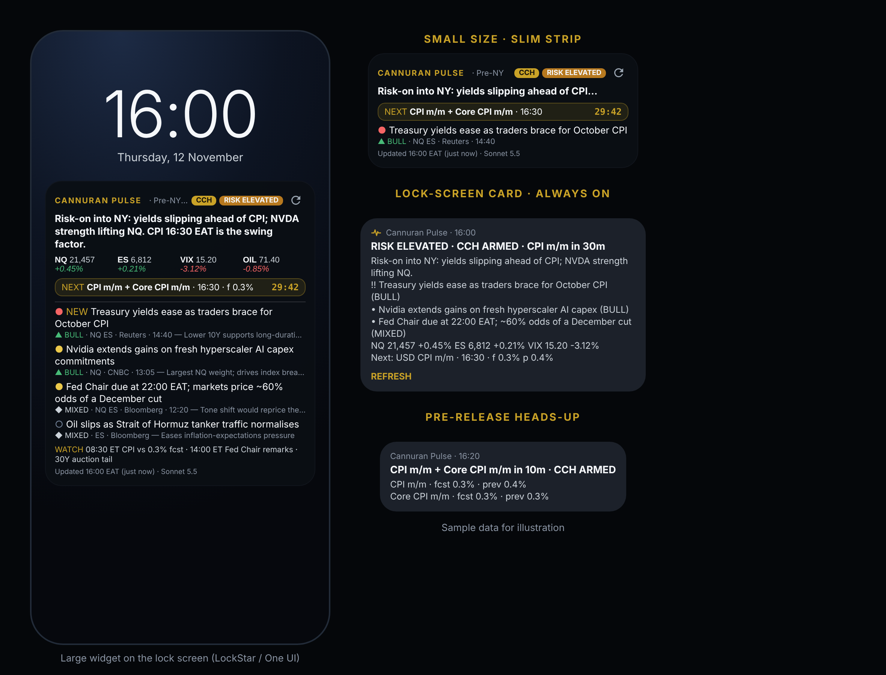

# Cannuran Pulse

**A Claude-powered NQ/ES news desk for your Galaxy S24 Ultra lock screen.**

Pulse is a small Android app with a lock-screen/home-screen widget. On a session-aware schedule it asks
Claude (Messages API + server-side web search) for the developments that matter to NQ and ES right now.
It then puts the result where you can see it without unlocking:



| On the widget | Where it comes from |
|---|---|
| **Net bias** for NQ/ES, plus the swing factor | Claude, after searching the last 12 h of news |
| **RISK LOW / ELEVATED / HIGH** chip | Claude |
| **CCH** chip: Contingent Catalyst Hedge armed | Deterministic: a CCH catalyst (FOMC, CPI, NFP, PCE, Fed Chair…) is on today's CME calendar. Claude can also arm it for unscheduled shocks |
| **NEXT** high-impact release with a **live countdown** (seconds tick on the lock screen) | ForexFactory weekly calendar feed |
| 3–5 **headlines**, each tagged impact ●, ▲ BULL / ▼ BEAR / ◆ MIXED, instruments, source, time and *why it matters*. Tap one to open the article | Claude, paraphrased, with source URLs from its searches |
| **NQ · ES · VIX · OIL** quotes | Yahoo Finance chart endpoint (may be delayed) |
| **WATCH** line, freshness and model footer, **STALE** warning | Claude + local bookkeeping |

The same brief also drives:

- **A persistent lock-screen card.** This is a silent ongoing notification that always shows on the lock
  screen and updates with every brief. It's the guaranteed fallback if One UI won't host the widget there. On
  Android 16 it also asks to be promoted as a *Live Update* (status-bar chip, and the Now Bar where One UI
  supports it).
- **Alerts** when a *new* HIGH-impact headline appears.
- **A heads-up N minutes before each high-impact release**, e.g. "CPI m/m + Core CPI m/m in 10m · CCH ARMED ·
  fcst 0.3% · prev 0.4%".
- **A fresh brief N minutes after the print**, with Claude told to report actual vs forecast and the reaction.

There is no server and no subscription. The phone talks directly to `api.anthropic.com` with your own API key.

---

## 1. Get the APK onto the phone

This repo contains a GitHub Actions workflow (`.github/workflows/build-apk.yml`). It runs the unit tests,
builds a signed release APK and publishes it as a GitHub Release.

1. Push this folder to a GitHub repository. A **private** repo is recommended (see [Security](#security)).
2. The workflow runs on every push to `main`. You can also start it from **Actions → Build Cannuran Pulse APK
   → Run workflow**.
3. On the S24 Ultra, open the repo's **Releases** page and tap **`CannuranPulse.apk`**. Allow "Install unknown
   apps" for your browser when asked. After the first build, this link always points to the newest APK:
   `https://github.com/<you>/<repo>/releases/latest/download/CannuranPulse.apk`
4. Every build is signed with the same key, so new versions install over old ones and keep your settings.

To build locally instead, open the folder in Android Studio and run `./gradlew assembleRelease`. The APK lands
in `app/build/outputs/apk/release/`.

## 2. First run (2 minutes)

1. Open **Cannuran Pulse** and allow notifications.
2. **API key.** Create one at console.anthropic.com → API keys, paste it in, and tap **Save key**.
   Web search must be enabled for your organization in the Console. If it isn't, the footer will tell you.
3. Tap **Disable battery optimisation**. Samsung aggressively kills background work, and this is the difference
   between a live widget and a stale one.
4. Tap **Allow precise alarms**, so pre-release heads-ups fire on the minute even in Doze.
5. Your first brief arrives within about a minute.

## 3. Put it on the lock screen

There are three routes. Use whichever your One UI build allows. The settings screen has the same steps under
**How to put Pulse on the lock screen**.

- **A. One UI lock screen.** Wake the screen, long-press an empty area of the lock screen (or *Settings →
  Wallpaper and style → Lock screen*), tap the widget area and look for **Cannuran Pulse**. The widget declares
  the `keyguard` category, so hosts that list third-party lock-screen widgets will offer it.
- **B. Good Lock → LockStar** (works on any Galaxy). Install *Good Lock* from the Galaxy Store and add the
  *LockStar* module. Turn it on, tap the lock-screen preview, then **Add widget → Cannuran Pulse**. Size it to
  about 4×3 for the full view, or 4×1–2 for a slim strip.
- **C. The lock-screen card** (no setup). Leave **Persistent lock-screen card** on. Also make sure *Settings →
  Notifications → Lock screen notifications* is set to show content.

The widget adapts to its size. Small shows the header, bias, next release and the top headline. Medium adds
quotes and 3 headlines. Large shows 5 headlines plus the watch list.

## 4. Schedule and cost

Pulse refreshes the free data (calendar, quotes) every 15 minutes. **Paid Claude briefs follow a cadence:**

| Mode | When | Default |
|---|---|---|
| Event | 45 min before → 30 min after any High-impact release | every 15 min |
| Active | Your active window in local time | 10:00 → 01:00 EAT, every 60 min (covers London open through the NY close) |
| Off-hours | Weekdays outside the window | every 240 min |
| Weekend | Fri 17:00 ET → Sun 18:00 ET (CME closed) | off |
| Post-release | 3 min after each High-impact print | 1 brief |
| Manual | ⟳ on the widget, Refresh on the card or in the app | on demand |

Each brief is one API call with up to 5 web searches. Search results count as input tokens, and searches
are billed at $10 per 1,000. A typical brief is about 20k input tokens, 1k output tokens and 4 searches:

| Profile | Briefs per trading day | Sonnet 5.5 | Haiku 5.5 | Opus 5.5 |
|---|---|---|---|---|
| **Default** | ≈ 26 | ≈ $2.30/day (≈ $49 / 21 days) | ≈ $1.10/day (≈ $23) | ≈ $3.60/day (≈ $76) |
| Lean: active every 120 min, off-hours off | ≈ 17 | ≈ $1.55/day (≈ $33) | ≈ $0.75/day (≈ $15) | ≈ $2.40/day |
| Event-centric: active every 240 min | ≈ 14 | ≈ $1.25/day (≈ $27) | ≈ $0.60/day (≈ $13) | ≈ $2.00/day |

The settings screen shows **today's actual usage** (briefs, searches, tokens, dollars) from the API's own
`usage` fields. The estimate switches to your measured cost per brief once you have data. Settings are clamped
to safe bounds: cadence ≥ 15 min and ≤ 10 searches per brief, so a typo can't run up a bill.

## 5. Make it yours

Everything that shapes the brief can be edited in the app:

- **Desk context.** This is the paragraph sent to Claude describing who you are and what moves you. It is
  pre-filled with Cannuran's setup: NQ/ES prop accounts, an ICT approach focused on the London and NY AM
  sessions, the NAS100 CFD hedge, CCH triggers, and the mega-cap/semis list.
- **CCH catalyst keywords** arm the CCH chip on matching calendar days (default: FOMC, Federal Funds Rate,
  CPI, Non-Farm, NFP, Fed Chair, PCE, Core PCE).
- **Quote symbols** use Yahoo syntax, e.g. `NQ=F, ES=F, ^VIX, CL=F, ^TNX, DX-Y.NYB`.
- **Calendar currencies** (default `USD`) and whether Medium-impact releases are included.
- **Model, cadences, active window, look-back hours, searches per brief, heads-up/post-release timing,
  translucent background.**

## 6. How it works

```
 WorkManager (15 min) ─┐        AlarmManager (T−10m, T+3m) ─┐      ⟳ widget / card / app
                       ▼                                     ▼                 ▼
                ┌──────────────────────── RefreshWorker (serialised) ────────────────────────┐
                │ RefreshEngine (pure Kotlin, fully unit-tested)                             │
                │  1. ForexFactory calendar  (hourly)  → filter USD High/Med, CCH catalysts  │
                │  2. Yahoo quotes           (each run, best effort)                         │
                │  3. Cadence.decide()  → due? → Claude Messages API + web_search tool       │
                │        system prompt (cached) + context: time in UTC/NY/Nairobi, session,  │
                │        calendar ±36h with fcst/prev, headlines already on screen           │
                │        handles pause_turn continuation; parses JSON; dedupes; marks NEW    │
                └───────────────┬───────────────────────────┬──────────────────┬────────────┘
                                ▼                           ▼                  ▼
                     Widget (RemoteViews,         Lock-screen card      Alerts: new HIGH
                     3 size tiers, live           (ongoing, Live        headline, pre-release
                     Chronometer countdown)       Update request)       heads-up
```

```
app/src/main/java/capital/cannuran/pulse/
  core/        platform-free logic: Json, Models, Settings/Cost, Calendar + MarketClock, Cadence,
               Prompt, ClaudeProtocol, BriefParser + Novelty, Quotes, Format, RefreshEngine
  data/        Store (prefs), SecretBox (Keystore AES-GCM), AndroidHttp
  work/        RefreshWorker, Scheduler, EventAlarms, BootReceiver
  widget/      PulseWidgetProvider, WidgetRenderer
  notify/      Notifier (card, alerts, Live Update request), ActionReceiver
  ui/          SettingsActivity
app/src/test/  JUnit tests for everything in core/
tools/         run-core-tests.sh, check-android-compile.sh, Android API stubs, JUnit shim
```

## 7. Tests

- `./gradlew testDebugUnitTest` runs 46 JUnit tests covering:
  - JSON round-trips
  - calendar parsing, filtering and CCH arming, including the CME trading-day rollover
  - session clock across EST, the maintenance break and weekends
  - cadence modes and midnight-wrapping windows
  - brief parsing: fences, prose, braces inside strings, duplicates, bad URLs, future timestamps, novelty
  - Claude request shape: cached system prompt, tool, max_uses, context
  - `pause_turn` resumption
  - API error mapping, graceful degradation, alert selection, persistence, and cost
- `tools/run-core-tests.sh` runs the same tests with nothing but a JDK and a Gradle distribution (no Android
  SDK, no network).
- `tools/check-android-compile.sh` type-checks the Android layer against API stubs, for fast feedback without
  the SDK.

## Security

- The API key is encrypted with an AES-256-GCM key held in the Android Keystore (hardware-backed on the S24
  Ultra). It is only ever sent to `api.anthropic.com`. Backups are disabled.
- The app talks to exactly three hosts: `api.anthropic.com`, `nfs.faireconomy.media` and
  `query1.finance.yahoo.com`. Cleartext HTTP is disabled.
- **Signing key.** `signing/pulse-sideload.jks` is committed so CI builds are consistently signed with zero
  setup. Anyone with this repo could sign an APK that installs as an update. Keep the repo **private**, or
  replace the key:
  1. Generate your own keystore with `keytool`.
  2. Add the repo secrets `PULSE_KEYSTORE_BASE64`, `PULSE_KEYSTORE_PASSWORD`, `PULSE_KEY_ALIAS` and
     `PULSE_KEY_PASSWORD`. The workflow uses them automatically.
  3. Uninstall once, since the signatures differ.

## Troubleshooting

| Footer / status says | Fix |
|---|---|
| `API key rejected` | Re-paste the key, which must start with `sk-ant-` |
| `Enable web search for your org…` | Turn on web search in the Claude Console |
| `Rate limited` / `overloaded` | Nothing to do. The next cycle retries and the previous brief stays on screen |
| `STALE · Updated …` | Battery optimisation is killing refreshes. Tap *Disable battery optimisation*, or set Battery → Unrestricted |
| Card missing on lock screen | Allow notifications, and set Lock screen notifications to show content |
| Widget not listed on the lock screen | Use Good Lock → LockStar, or rely on the lock-screen card |
| `Calendar: …` errors | The ForexFactory feed is rate-limited or down. Briefs still work; the calendar retries hourly |

---

News is summarised by an AI from public sources and may be incomplete or wrong. Verify before acting.
Information only, not investment advice.
